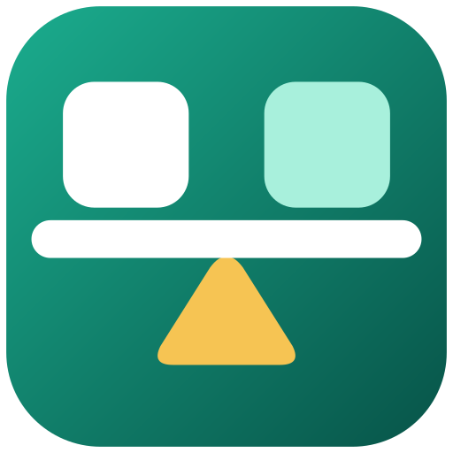

#  DoubleEntry

Personal double-entry bookkeeping for Android and Windows, written in Kotlin, with an optional
Supabase backend for cloud backup and sync. The bookkeeping rules, reports, statement import and
sync are shared Kotlin Multiplatform code; each app has its own native UI (Jetpack Compose with
Material 3 on Android, Compose Desktop with Fluent on Windows). The plan for more platforms is in
[`docs/multiplatform-plan.md`](docs/multiplatform-plan.md).

- **Accounts.** Net worth at a glance, accounts grouped by type, monthly ledger per account with running balance.
  Reconcile an account against a bank statement (optionally posting the difference as an adjustment);
  later changes to the reconciled period show up as drift.
- **Bank statement import.** Import an account's CSV/TSV or Excel (.xlsx) export from the bank: delimiter, encoding,
  columns, dates and number formats are detected (and can be corrected), rows already in the ledger are skipped, and
  transactions in the period that the file doesn't contain are flagged. New rows are booked like the latest
  transaction with the same text, can be split across several accounts, and a row that pays an open invoice is booked
  as its payment.
- **Transactions.** Balanced multi-line entries with an account picker, auto-balancing, edit, duplicate and delete
  (with undo). Typing a title suggests earlier transactions and copies their lines. Search covers all months.
- **Recurring transactions.** Weekly, monthly, quarterly or yearly postings (rent, salary, subscriptions) that post
  themselves when the app opens.
- **Reports.** Balance sheet, income statement (EBITDA/EBDA/EBT, spendable net income), cash flow and a cost-trends chart.
  Month, year-to-date or year, with comparison against the previous period or the same period last year.
- **Assets.** Automatic monthly depreciation write-offs, with a repair tool for missing ones.
- **Invoices.** Booking, due-date tracking, payment in full or in instalments, and an optional daily reminder notification.
- **Cloud backup & sync.** Offline-first local database, last-edit-wins sync with Supabase, realtime updates between
  devices. Accounts are created in the app; uploading is a Google Play subscription (see
  [`docs/google-play.md`](docs/google-play.md#paid-cloud-backup)), downloading a backup is always free.
- **Backups.** JSON export/import. CSV export of transactions and balances.
- Light/dark theme, optional Material You (wallpaper) colors, optional app lock (screen lock or biometrics),
  a net-worth home-screen widget and launcher shortcuts.

## Build and run

1. Open this folder in Android Studio (*File → Open*). Use the bundled JDK (Android Studio's JBR, Java 21).
2. Let Gradle sync, then run the **app** configuration on a device or emulator (Android 8.0 / API 26+).

From a terminal: `./gradlew assembleDebug` builds `app/build/outputs/apk/debug/app-debug.apk`,
`./gradlew :shared:jvmTest testDebugUnitTest :desktopApp:test` runs the unit tests.

### Desktop (Windows)

`./gradlew :desktopApp:run` starts the desktop app (on Windows, macOS or Linux; it's designed for
Windows 11). `./gradlew :desktopApp:packageReleaseMsi` builds the Windows installer, on Windows
only; the [Desktop workflow](.github/workflows/desktop.yml) builds it on every push. The app keeps
its data in `%LOCALAPPDATA%\DoubleEntry` (`-Ddoubleentry.dataDir=…` points it elsewhere) and uses
the same `local.properties` Supabase settings as the Android app.

Desktop-first rather than a stretched phone screen: account list, ledger and transaction side by
side in resizable panes, wide tables with keyboard navigation (arrow keys, Enter to edit), right-click
menus, the transaction editor and statement import in windows of their own, bank statements dropped
onto an account's ledger, and shortcuts (Ctrl+N new transaction, Ctrl+F search, Ctrl+1–5 sections,
Ctrl+Enter to save). It follows the Windows light/dark setting and accent color.

Build types:

| Build | Application id | Name on device | Notes |
|---|---|---|---|
| debug | `com.soloit.doubleentry.dev` | DoubleEntry Dev | Installs next to the release app. Cloud sync on. Allows plain HTTP to a local Supabase stack. |
| release | `com.soloit.doubleentry` | DoubleEntry | The Google Play build: minified with R8. Cloud backup and the Supabase settings are left out unless `cloudSync.enabled=true` (or `CLOUD_SYNC_ENABLED=true`). |

To sign release builds, create `keystore.properties` in the project root (git-ignored):

```properties
storeFile=/path/to/upload-key.jks
storePassword=…
keyAlias=…
keyPassword=…
```

CI signs with the `SIGNING_STORE_FILE`, `SIGNING_STORE_PASSWORD`, `SIGNING_KEY_ALIAS` and
`SIGNING_KEY_PASSWORD` environment variables instead. Publishing on Google Play (upload key, store
listing, privacy policy, Data safety answers) is described in [`docs/google-play.md`](docs/google-play.md).

## Configure Supabase

Add your project settings to `local.properties` (git-ignored; Android Studio created it with `sdk.dir`):

```properties
supabase.url=https://<project-ref>.supabase.co
supabase.anonKey=<anon / publishable key from Project Settings → API>
```

Without them the app builds and works offline; the cloud sync settings are simply hidden.
Cloud sync is on in debug builds and off in release builds; `cloudSync.enabled=true|false` (or
`CLOUD_SYNC_ENABLED`) overrides that for both. A build without cloud sync doesn't embed the
Supabase settings. CI reads the same values from the `SUPABASE_URL` / `SUPABASE_ANON_KEY`
environment variables.

Everything on the server (tables, row-level security, triggers, realtime) lives in
[`supabase/`](supabase/README.md) and can be deployed from the repository.

### Sign in with Google

Accounts are created with Sign in with Google (Credential Manager, no browser). Add the OAuth web
client id next to the Supabase settings (CI: `GOOGLE_WEB_CLIENT_ID`):

```properties
google.webClientId=<id>.apps.googleusercontent.com
```

Without it the app can't sign in. The desktop app signs in through the system browser instead
(Supabase's own Google sign-in with PKCE, returning to a port it opens on `127.0.0.1`), so it
needs no client id of its own, but the Supabase project needs:

- the Google provider's *Client Secret* (of the web client), and the web client's *Authorized
  redirect URIs* in Google Cloud must include `https://<project-ref>.supabase.co/auth/v1/callback`;
- `http://127.0.0.1:*/auth/callback` under *Authentication → URL Configuration → Redirect URLs*
  (the local stack has it in `supabase/config.toml`).

To create the ids, in the Google
Cloud project linked to the Play Console app (*APIs & Services*):

1. *OAuth consent screen*: app name *DoubleEntry*, user type *External*, scopes `openid`, `email`
   and `profile` only (no verification needed for these), then publish it.
2. *Credentials → Create credentials → OAuth client ID → Web application*. Its id is
   `google.webClientId` and goes into Supabase (*Authentication → Sign In / Providers → Google*).
3. One *OAuth client ID → Android* per signing key, each with the package name and the key's SHA-1.
   Google only checks that one exists; the app never uses these ids:

   | Package | SHA-1 of |
   |---|---|
   | `com.soloit.doubleentry.dev` | the debug key: `keytool -list -v -keystore ~/.android/debug.keystore -storepass android` |
   | `com.soloit.doubleentry` | the upload key: `keytool -list -v -keystore upload-key.jks` |
   | `com.soloit.doubleentry` | the app signing key: Play Console → *Test and release → App integrity* (installs from Play are signed with it) |

## How it behaves

- **App data without its own table** (recurring rules, reconciliations, invoice instalments) is stored as
  synced `user_settings` rows (`Recurring.<id>`, `Reconciliation.<accountId>`, `Invoice.Payments.<invoiceId>`).
  Recurring postings use ids derived from (rule, date), like depreciation, so two devices posting the same
  occurrence converge on one transaction. Backups carry this data in the `android` extension.
- **Instalments.** An invoice row is only marked paid by the payment that settles the rest.
- **Concurrent edits.** A transaction syncs as one row with its lines, so when two devices edited the same
  transaction before syncing, the later edit is kept whole (never a mix, and never both line sets). The later
  edit wins by when it was made, not by which device came online first, and the server enforces it.
- **Default plan seeding.** Seeded accounts get the oldest possible timestamp, so accounts already
  in the cloud (renamed or deleted elsewhere) win over freshly seeded defaults when you sign in.
- **Tiny assets.** An asset whose monthly write-off rounds to 0.00 is written off at least 0.01 per month.
- **Deleting an account** with transactions is refused by the data layer itself, not only by the UI.
- **Cash flow** only counts asset accounts that match a cash group's prefixes.
- **Transaction lines.** A line with an amount but no account is an error instead of being silently dropped.
- **Balance sheet** hides zero-balance accounts unless *Show empty accounts* is selected.
- **Sync** runs when the app comes to the foreground, refreshes an expired session once
  before failing, and the realtime connection reconnects with backoff. A banner above the tab bar
  shows when changes aren't reaching the cloud (offline, paused, failing, session expired) and
  when unsynced edits were replaced by newer ones from another device. Sync stamps are corrected
  for device clock skew, measured from the server's `Date` header. Signing in never silently
  merges two ledgers: it asks when this device and the account each hold one, when changes were
  made while signed out, or when the device holds another account's ledger. *Delete all* and
  *Import* also delete cloud rows this device never pulled, and *Reset this device* uploads first
  and warns about anything it couldn't upload.

## Project structure

```
shared/            Kotlin Multiplatform (Android and JVM), used by both apps
  src/commonMain/kotlin/com/soloit/doubleentry/
    domain/        Pure Kotlin: models, money, deterministic ids, depreciation, report calculators
    data/          Room database and repositories (ledger, assets, invoices, settings, backup)
    sync/          Supabase auth + PostgREST client, push/pull engine, realtime, session storage
    ui/            Screen state: each screen's ViewModel, which both apps' screens display
    platform/      What each app provides: key-value storage, logging
    AppCore.kt     The ledgers on the device, sync and startup work, wired once for every app
  src/jvmTest/     Unit tests (incl. fixed values for the deterministic ids), the repositories on an
                   in-memory database and sync between two devices (fake PostgREST)
  schemas/         Exported Room schema (keep under version control for migrations)
app/               The Android app
  src/main/java/com/soloit/doubleentry/
    system/        Invoice reminders (WorkManager), app lock, widget, shortcuts, Keystore token storage
    billing/       Google Play subscriptions
    ui/            Compose screens per feature, shared components and theme
desktopApp/        The Windows app (Compose Desktop, Fluent design)
  src/main/kotlin/com/soloit/doubleentry/desktop/
    platform/      Data folder, DPAPI token storage, browser sign-in, notifications, title bar
    ui/            Pages, panes and windows per feature
  src/test/        Renders every page to build/screenshots; enters a transaction by keyboard
  icons/           App icon (rendered from DoubleEntry.svg)
supabase/          Migrations, maintenance queries and CLI config for the backend
```

Amounts are stored as `Long` cents everywhere; dates as ISO `yyyy-MM-dd`. All deletes are soft
(tombstones) so they replicate.

## Continuous integration

- `.github/workflows/android.yml` runs the unit tests and builds a debug APK on every push and pull request.
- `.github/workflows/desktop.yml` tests the desktop app (keeping the page screenshots) and builds the
  Windows installer on every push and pull request.
- `.github/workflows/release.yml` builds the signed Play bundle when a `v*` tag is pushed and can upload it
  to the internal testing track. Setup is in [`docs/google-play.md`](docs/google-play.md).
- `.github/workflows/supabase.yml` validates the migrations on a throwaway Supabase stack (security
  tests, re-runs and an upgrade over existing data), tests the Edge Functions, previews the migrations
  on pull requests and applies them to your project on push. Setup is in
  [`supabase/README.md`](supabase/README.md#deploy-from-github).
- `.github/workflows/sync-contract.yml` runs the sync contract tests against a real local Supabase
  stack, the same tests the Android workflow runs against the in-memory fake
  ([Testing](supabase/README.md#testing)). Before releasing sync changes, see
  [`docs/release-checklist.md`](docs/release-checklist.md).

## Support

Questions, bug reports and feature requests go to [issues](https://github.com/Soloit-Technologies/doubleentry/issues/new/choose)
(*Settings → Support* in the app opens the same forms). Issues are public, so never post your own
financial data. Report security problems privately, see [`SECURITY.md`](SECURITY.md). The privacy
policy is [`PRIVACY.md`](PRIVACY.md); the user guide is at [doubleentry.eu](https://doubleentry.eu).

## License

DoubleEntry is open source. Copyright © Soloit Technologies AB.

| Part | License |
|---|---|
| The apps: this Android app and the planned iOS and Windows apps | [Mozilla Public License 2.0](LICENSE) |
| The backend: everything in [`supabase/`](supabase/) | [GNU Affero General Public License v3.0](supabase/LICENSE) |

- **The apps (MPL-2.0).** You may use, change and redistribute the code, also in apps built for
  other platforms and in closed-source projects. Files you change must stay under MPL-2.0 and
  their source must be made available. MPL-2.0 permits distribution through app stores such as
  Google Play, the Apple App Store and the Microsoft Store.
- **The backend (AGPL-3.0).** If you run a changed version of the backend as a service for others,
  you must make the changed source available to its users. Apps that only talk to the backend over
  its API are not affected.
- **Contributions** are accepted under the license of the part they change, so they can be
  shipped in the official apps on every platform.
- **Name and icon.** The licenses don't cover the DoubleEntry name, the Soloit name or the app icon
  and artwork. Forks must use a different name and icon and must not present themselves as the
  official app.

iOS and Windows versions are planned. No date yet.
